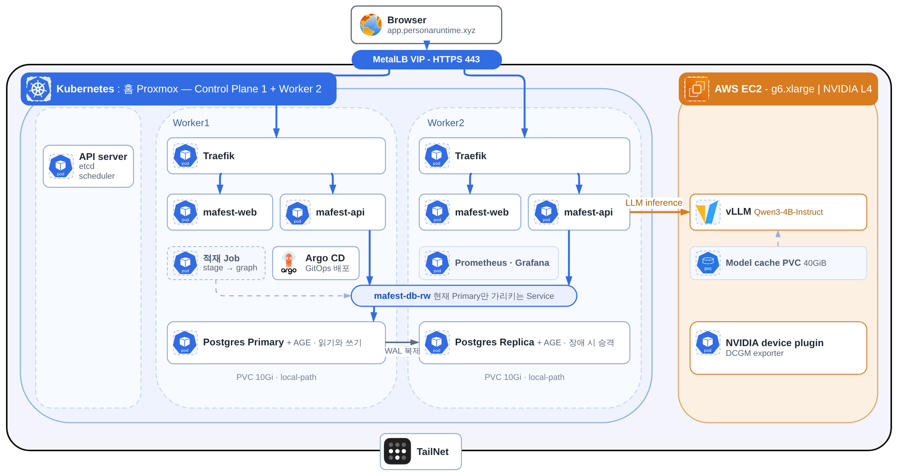

# mafest-platform

MAfest Runtime의 Kubernetes, 네트워크, 스토리지, 배포 선언과 운영 절차.
애플리케이션 코드와 DB 테이블 migration은 각 서비스 저장소가 맡는다.

## 구성도



편집 원본은 [`assets/architecture-mafest-runtime.drawio`](assets/architecture-mafest-runtime.drawio)다.

## 구성 요소

| 구분 | 내용 |
| --- | --- |
| 노드 | 홈 Proxmox 한 대 위의 Control Plane 1대와 Worker 2대. GPU는 AWS g6.xlarge(NVIDIA L4) 노드 |
| 네트워크 | Cilium VXLAN과 kube-proxy. 홈과 AWS 노드 사이는 Tailscale |
| 진입 | 사용자 → MetalLB VIP(HTTPS) → Traefik → mafest-web, mafest-api |
| 앱 | mafest-web과 mafest-api 각 2 replica. 공개 API 계약 1.6.0. 운영 설정은 [`api-deployment.yaml`](kustomize/base/mafest-app/api-deployment.yaml) |
| DB | PostgreSQL과 Apache AGE를 CNPG가 관리한다. Worker1이 Primary, Worker2가 Replica. 접속은 `mafest-db-rw` Service |
| 추론 | namespace `persona-inference`의 vLLM. 모델은 Qwen3-4B-Instruct-2507 공식 FP8 체크포인트, vLLM 0.29, CPU n-gram speculative decoding. 컴파일 캐시는 PVC |
| 관측 | Prometheus와 Grafana. 대시보드 JSON은 별도 저장소에서 생성한다 |
| GitOps | Argo CD. 수동 Sync만 쓴다 |

## 디렉터리

| 경로 | 내용 |
| --- | --- |
| `ansible/` | GPU 노드와 mem-lab 워커 호스트 설정 playbook |
| `argocd/`, `bootstrap/` | Argo Application 선언, Argo 밖에서 설치하는 Cilium, CNPG Operator, CoreDNS, local-path, Traefik, namespace, 모델 seed |
| `db/`, `helm/`, `deploy/` | DB 역할·권한 SQL, Helm values, 승인 Sync 기록 |
| `kustomize/base/` | 리소스 정의 |
| `kustomize/overlays/{prod,exp}/` | 운영 Application과 수동 적용 대상, 실험 overlay(`persona-vllm-bf16`은 롤백용) |
| `scripts/` | 렌더·정책 검증과 Sync 사전 점검 |
| `terraform/`, `assets/` | AWS GPU 노드·라우터·mem-lab 선언, 구성도 |

## 배포

Argo CD는 자동 Sync와 prune 없이 revision을 정해 수동으로 Sync한다.
Sync 전에 `scripts/argo-preflight.sh <app>`으로 승인 SHA와 diff를 확인한다.

| Application | 대상 경로 |
| --- | --- |
| `cert-manager`, `metallb`, `dcgm-exporter` | Helm chart |
| `cert-manager-issuers` | `kustomize/overlays/prod/cert-manager-issuers` |
| `metallb-config` | `kustomize/overlays/prod/metallb-config` |
| `monitoring-stack` | Helm chart와 `kustomize/overlays/prod/grafana-dashboards` |
| `nvidia-device-plugin` | `kustomize/overlays/prod/nvidia-device-plugin` |
| `gpu-runtime` | `kustomize/overlays/prod/gpu-runtime` |
| `public-gateway` | `kustomize/overlays/prod/public-gateway` |
| `maintenance-page` | `kustomize/overlays/prod/maintenance-page` |
| `persona-edge` | `kustomize/overlays/prod/persona-edge` |
| `mafest-app` | `kustomize/overlays/prod/mafest-app` |
| `mafest-app-netpol` | `kustomize/overlays/prod/mafest-app-netpol` |
| `mafest-db` | `kustomize/overlays/prod/mafest-db` |
| `mafest-db-netpol` | `kustomize/overlays/prod/mafest-db-netpol` |

Argo 밖에서 사람이 `kubectl apply -k`로 적용하는 대상과 이유는 다음과 같다.

| 대상 | 이유 |
| --- | --- |
| `persona-vllm`, `persona-model-cache`, `persona-model-seed-*` | 모델 로딩과 캐시는 기동 순서와 자원 확인이 필요해 Application을 만들지 않는다 |
| `persona-inference-netpol` | vLLM 정책은 allow를 먼저, default-deny를 마지막에 적용한다. kubectl은 sync-wave를 읽지 않는다 |
| `traefik-networkpolicy`, `traefik-observability` | Traefik 본체가 Helm으로 Argo 밖에 설치돼 있어 같은 방식으로 다룬다 |
| `mafest-load`, `exp/persona-vllm-bf16` | 일회성 적재 Job(stage → graph), BF16 비교와 롤백 |

`persona-*` 이름(edge, inference, vllm, model-cache, model-seed)은 이전 이름을 이어 쓰는 리소스다.

## 로컬 검증

이 저장소 루트에서 실행한다. kubectl 로컬 Kustomize 렌더, Ruby, 셸이 필요하며 운영 Sync는 하지 않는다.

```sh
kubectl kustomize kustomize/overlays/prod/maintenance-page
sh scripts/validate-public-gateway-manifests.sh && sh scripts/test-public-gateway-manifests.sh
sh scripts/validate-networkpolicy-manifests.sh && sh scripts/test-networkpolicy-manifests.sh
bash scripts/argo-preflight.sh --self-test
sh scripts/validate-monitoring-manifests.sh   # Helm chart를 네트워크로 받아 렌더한다
sh scripts/validate-mem-lab-declarations.sh
sh scripts/test-mem-lab-negative.sh           # terraform 필요
```

mafest 데이터·앱, vLLM, 모델 cache 선언의 검증기는 별도 비공개 저장소에서 관리한다.
검사 성공은 실제 스케줄링과 무중단 배포의 증거가 아니다. Secret 값과 사용자 자료는 Git에 넣지 않는다.

## 운영 변경 절차

1. context, 대상, 현재 상태와 백업·복구 수단을 확인한다.
2. 선언 diff와 로컬 검사 결과를 검토하고, CP에서 server dry-run을 수행한다.
3. 승인한 변경만 커밋하고 Argo diff를 확인한다.
4. 지정한 revision을 수동 Sync하고 서비스, 데이터, 관측 상태를 검증한다.

DB Application의 Sync에 앱 migration이나 무관한 변경을 섞지 않는다.
PVC/PV 삭제, 노드 장애 주입, 클라우드 자원 생성은 각각 별도 승인 대상이다.

## 고정 제약

- 단일 물리 호스트와 CP가 장애 지점이다. 워커 분산은 물리 장애를 견디는 HA가 아니다.
- local-path 데이터는 다른 노드로 옮겨 가지 않는다.
- Retain은 데이터 보존 정책이며 백업이 아니다.
